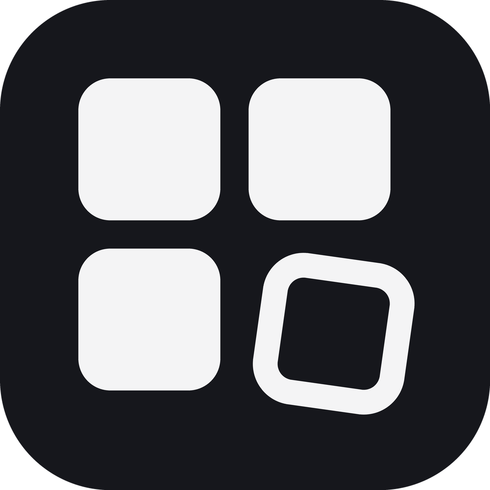
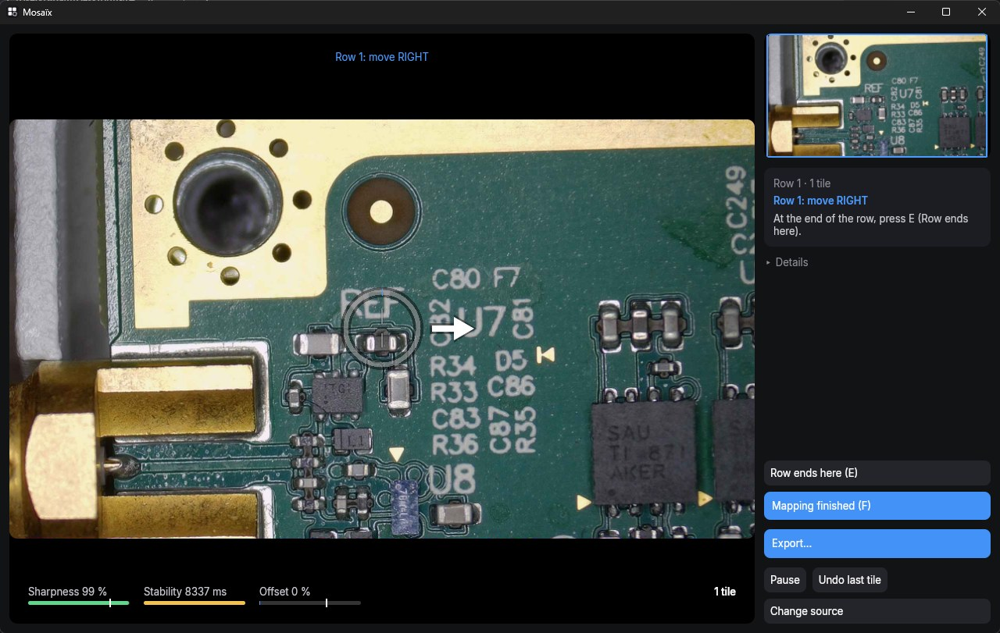

<div align="center">



# Mosaïx

**Map any flat object under a microscope, tile by tile, into one sharp image.**

[](https://github.com/adamhlt/Mosaix/actions/workflows/ci.yml)
[](https://github.com/adamhlt/Mosaix/releases/latest)


[](LICENSE)

</div>

---

Mosaïx is a native desktop app for USB microscopes and cameras. You slide the object under the
lens by hand, row after row; Mosaïx follows the movement live, captures a tile each time you pause
after a step, and stitches every tile into one large, seamless image. It's made for circuit
boards, microscope slides, documents and any other flat, textured surface.

<p align="center"></p>

## Features

**Capture**
- Live tracking of the movement by phase correlation, no motorised stage needed
- A tile is captured by itself once the view has moved far enough, is still and is sharp
- The sharpest of the last frames is kept, not the one that happened to trigger
- Guidance in a serpentine: which way to move, when a row ends, when to step down
- Undo the last tile, pause, and see the mosaic grow beside the live view
- Reads the modes the camera really offers (resolution, pixel format, frame rate)

**Stitch**
- Global registration of every overlap, so the drift of a long scan disappears
- A small rotation per tile, for an object turned a little between shots
- Brightness, colour and light fall-off matched between tiles
- Seams placed on the sharp side of each overlap when the focal plane is tilted

**Export**
- PNG, JPEG or TIFF, at 100 %, 50 % or 25 %
- The whole mosaic, or cropped to the largest fully covered rectangle
- Every session (tiles and their positions) is saved, and can be exported again later

## Shortcuts

| | |
| --- | --- |
| `E` | The row ends here: capture its last tile, then step down |
| `F` | Mapping finished · continue mapping once finished |
| `R` | Flip the direction of the rows |
| `U` | Undo the last tile |
| `Space` | Pause or resume |

## Tips

- Start at the top-left corner of the area to map; rows run left → right, then back.
- The object must be flat and textured. Repetitive patterns (wafers, grids, regular weaves) and
  bare areas (glass, blank paper) are hard to follow.
- Light and focus may be uneven across the field: Mosaïx corrects them when it stitches.

## Command line

```bash
mosaix --camera 0 --res 1920x1080            # skip the start menu
mosaix --list-modes                          # every camera and the modes its driver offers
mosaix --export sessions/session-123 out.png --scale 0.5 --crop   # stitch a saved session, no window
```

## Download

Get the latest build for Windows (setup or portable zip), macOS (universal `.dmg`) or Linux
(x86-64 `.tar.gz`) from [**Releases**](https://github.com/adamhlt/Mosaix/releases/latest).

On macOS the app isn't notarized: the first time, right-click it and choose **Open**. It asks for
the camera permission on first use.

## Build

```bash
cargo run --release
```

- **Toolchain**: `rust-toolchain.toml` pins the Rust version; rustup installs it on first use.
- **Linux**: needs `libxkbcommon-dev`, `libwayland-dev` and `libclang-dev`.
- **Core only**: `cargo test --release --no-default-features` builds and tests without the UI
  and the camera.
- **Icons**: `python packaging/make_icons.py` renders `assets/icon/` from the logo (needs Pillow).
- **Release**: pushing a `v*` tag builds all three platforms into one GitHub release.

## License

Mosaïx is free software under the [GNU General Public License v3.0](LICENSE) or any later version.

<div align="center"><sub>Built with <a href="https://github.com/anomalyco/rune">Rune</a></sub></div>
